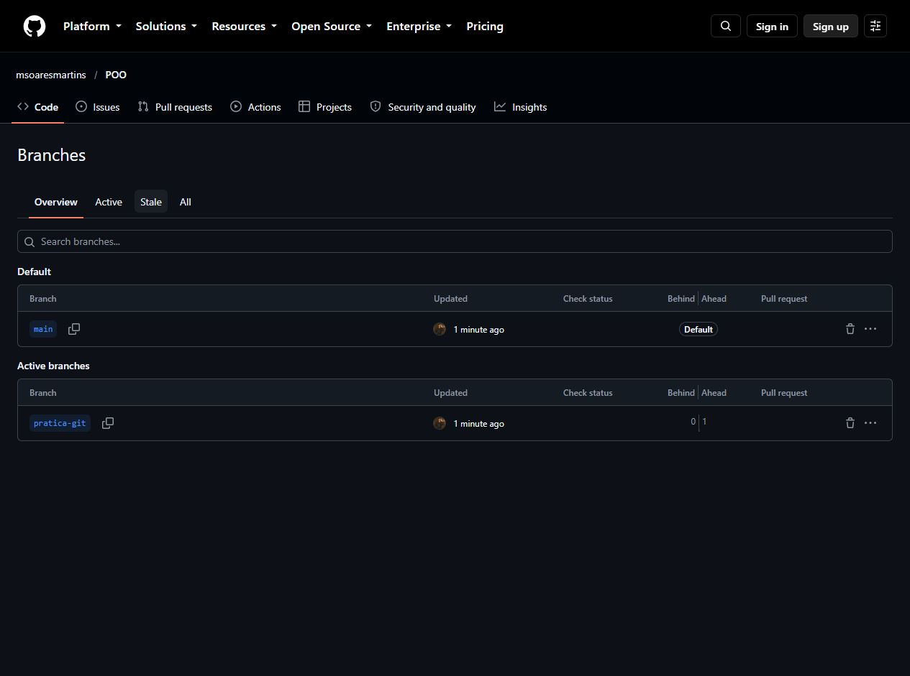
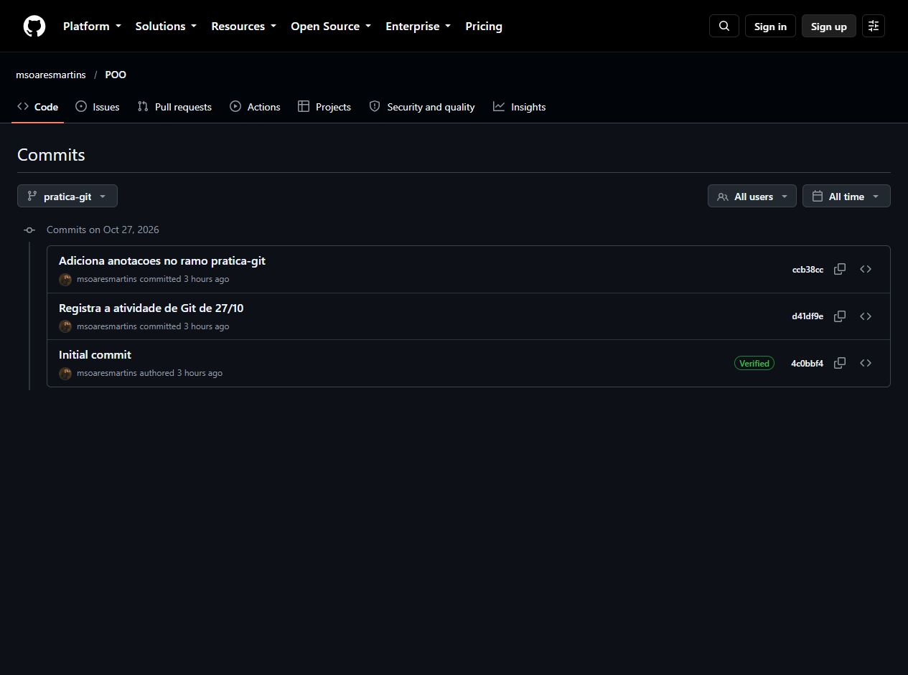

# Prática de Git — Programação Orientada a Objetos

Exercício de Git da disciplina de Programação Orientada a Objetos.

## Criação e clonagem

Criei o repositório público `POO` com um README e fiz a cópia para o computador com `git clone https://github.com/msoaresmartins/POO.git`.

## Alteração na main

Mudei o README para identificar a prática. Depois adicionei o arquivo, fiz o commit e enviei para o GitHub:

```sh
git add README.md
git commit -m "Registra a atividade de Git de 27/10"
git push origin main
```

## Criação de outro ramo

Criei o ramo `pratica-git` e troquei para ele:

```sh
git branch pratica-git
git checkout pratica-git
```

Nesse ramo, acrescentei o arquivo `anotacoes-git.md` com um resumo dos comandos. Fiz o segundo commit, voltei para a `main` e enviei o ramo:

```sh
git add anotacoes-git.md
git commit -m "Adiciona anotacoes no ramo pratica-git"
git checkout main
git push --set-upstream origin pratica-git
```

O arquivo de anotações está [no ramo pratica-git](https://github.com/msoaresmartins/POO/blob/pratica-git/anotacoes-git.md). Na `main` ele não aparece.



## Histórico

O commit `d41df9e` é a alteração do README. O `ccb38cc` é a anotação feita no outro ramo.



As capturas são dos primeiros envios. Depois acrescentei os prints e este texto. Também guardei os [comandos executados](registros/02-comandos.txt).

