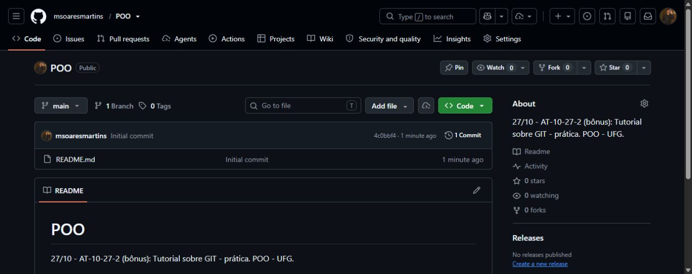
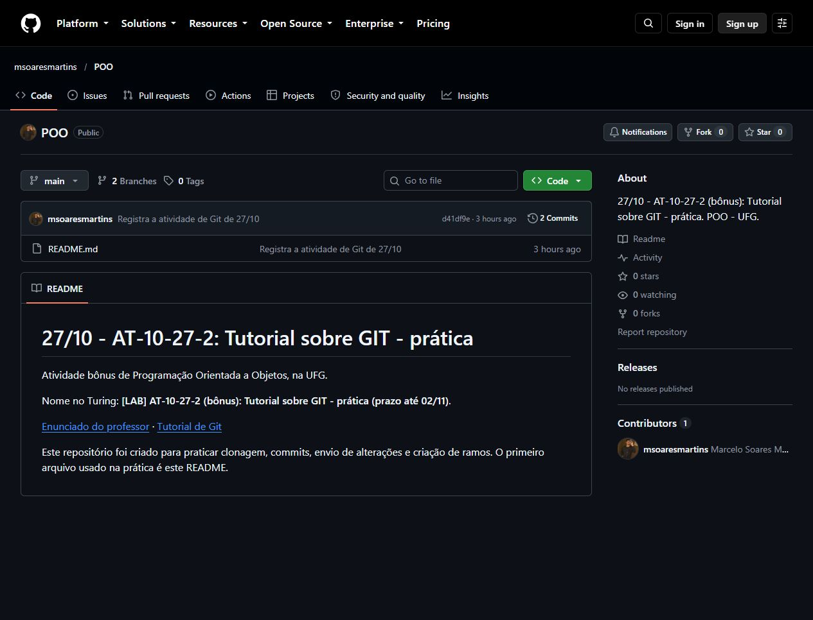

# 27/10 - AT-10-27-2 (bônus): Tutorial sobre GIT - prática

[LAB] · Prazo: 02/11 · [Enunciado no Turing](https://turing.inf.ufg.br/mod/forum/view.php?id=56956)

Nesta atividade, usei um README e um arquivo de anotações para testar os comandos do [tutorial de Git](https://github.com/marceloakira/tutorials/blob/main/git/tutorial_git.md).

## Repositório e clonagem

Criei o repositório público `POO` na minha conta, com um README inicial.



Depois fiz a cópia para o computador com `git clone https://github.com/msoaresmartins/POO.git`. A saída do comando está em [registros/01-clonagem.txt](registros/01-clonagem.txt).

## Primeiro commit e envio

Alterei o README para identificar a atividade e registrei a mudança na `main`:

```sh
git status --short
git add README.md
git commit -m "Registra a atividade de Git de 27/10"
git push origin main
```

O commit `d41df9e` apareceu no GitHub depois do envio.



## Segundo ramo

Criei o ramo `pratica-git`, entrei nele e acrescentei `anotacoes-git.md`. Depois fiz outro commit e enviei o ramo.

```sh
git branch pratica-git
git checkout pratica-git
git add anotacoes-git.md
git commit -m "Adiciona anotacoes no ramo pratica-git"
git checkout main
git push --set-upstream origin pratica-git
```

O commit dessa alteração é `ccb38cc`. O arquivo de anotações ficou [no ramo pratica-git](https://github.com/msoaresmartins/POO/blob/pratica-git/anotacoes-git.md).


## Conferência

Usei `git log --oneline --graph --all --decorate` para ver o histórico e `git ls-remote --heads origin` para conferir os dois ramos no GitHub.


O [registro dos comandos](registros/02-comandos.txt) contém as saídas reais, incluindo os dois `git push`. As capturas acima são do momento após esses envios; este relatório e os prints foram acrescentados depois.

Link para entrega: [github.com/msoaresmartins/POO](https://github.com/msoaresmartins/POO).
